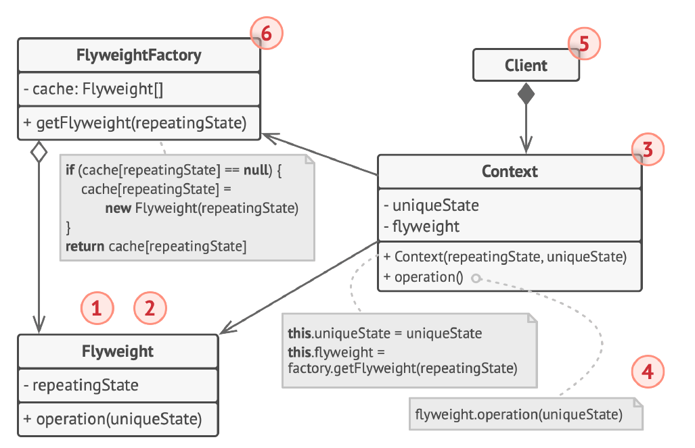
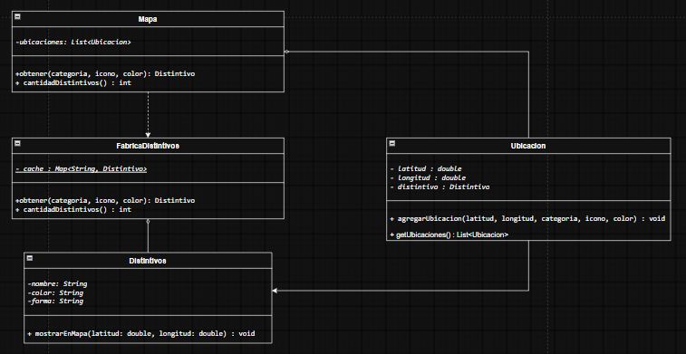

# Patrón Flyweight

## 1. ¿En qué consiste?

El patrón **Flyweight** permite reutilizar objetos que contienen
información compartida, evitando guardar muchas copias de los mismos
datos. Para hacerlo, separa el estado intrínseco, que se puede
compartir, del estado extrínseco, que es particular de cada objeto.

Imagina que estás creando un sistema de mapas digitales donde necesitas registrar ubicaciones diferentes (entre restaurantes, parques y supermercados). 
Si abordaras esto de la forma tradicional, crearías un objeto pesado por cada punto en el mapa que contenga absolutamente todos sus datos de forma independiente

## 2. Diagrama general


## 3. Problema

El mapa puede contener miles de ubicaciones. Si cada una almacenara por separado los mismos datos de categoría, icono y color (como en el ejemplo anterior), se repetiría información masivamente y se consumirían recursos de forma innecesaria por cada objeto creado.
Entonces por ejemplo a un usurio que tenga un dispositivo potente quizas podria usar el sistema con normaidad, pero igual etaria propenso a fallar o relentizarse.


## 4. Solucion


`FabricaDistintivos` reutiliza los objetos `Distintivo` que ya existen
para una misma combinación de categoría, icono y color. Cada `Ubicacion`
almacena sus coordenadas y una referencia al distintivo compartido.
`Mapa` reúne las ubicaciones y pide los distintivos a la fábrica.


## 5. Código

### `App.java`

``` java
public class App {
    public static void main(String[] args) {
        double baseLat = 4;
        double baseLon = -74;
        Mapa mapa = new Mapa();


        for (int i = 0; i < 10000; i++) {
            double lat = baseLat + i;
            double lon = baseLon + i;

            switch (i % 3) {
                case 0 -> mapa.agregarUbicacion(lat, lon, "Restaurante", "icono-restaurante.png", "rojo");
                case 1 -> mapa.agregarUbicacion(lat, lon, "Parque", "icono-parque.png", "verde");
                default -> mapa.agregarUbicacion(lat, lon, "Supermercado", "icono-supermercado.png", "azul");
            }
        }

        System.out.println("Cantidad de iconos de lugares en el mapa: " + mapa.getUbicaciones().size());
        System.out.println("Objetos intrinsicos (flyweights): " + FabricaDistintivos.cantidadDistintivos());

        Ubicacion u0 = mapa.getUbicaciones().get(0);
        Ubicacion u1 = mapa.getUbicaciones().get(1);
        Ubicacion u2 = mapa.getUbicaciones().get(2);

        u0.mostrarEnMapa();
        u1.mostrarEnMapa();
        u2.mostrarEnMapa();
    }
}
```

### `Distintivo.java`

``` java
// FLYWEIGHT: guarda el estado INTRINSECO (compartido e inmutable) de cada categoria.
public class Distintivo {

    private final String categoria;   
    private final String icono;       
    private final String color;      

    public Distintivo(String categoria, String icono, String color) {
        this.categoria = categoria;
        this.icono = icono;
        this.color = color;
    }

    // El estado EXTRINSECO (latitud, longitud) llega por parametro, no se guarda aqui.
    public void mostrarEnMapa(double latitud, double longitud) {
        System.out.println("Mostrando en mapa " + categoria + " icono: " + icono + ", color: " + color +  " en (" + latitud + ", " + longitud + ")");
    }
}
```

### `FabricaDistintivos.java`

``` java
import java.util.HashMap;
import java.util.Map;

// FABRICA FLYWEIGHT: entrega un objeto existente si ya hay uno con esas caracteristicas.
public class FabricaDistintivos {

    private static final Map<String, Distintivo> cache = new HashMap<>();

    public static Distintivo obtener(String categoria, String icono, String color) {
        String clave = categoria + "|" + icono + "|" + color;
        Distintivo distintivo = cache.get(clave);
        if (distintivo == null) {
            distintivo = new Distintivo(categoria, icono, color);
            cache.put(clave, distintivo);
        }
        return distintivo;
    }

    public static int cantidadDistintivos() {
        return cache.size();
    }
}
```

### `Mapa.java`

``` java
import java.util.ArrayList;
import java.util.List;

// CLIENTE / CONTENEDOR: crea muchas ubicaciones pero pide los distintivos a la fabrica.
public class Mapa {

    private final List<Ubicacion> ubicaciones = new ArrayList<>();

    public void agregarUbicacion(double latitud, double longitud, String categoria, String icono, String color) {
        Distintivo distintivo = FabricaDistintivos.obtener(categoria, icono, color);
        ubicaciones.add(new Ubicacion(latitud, longitud, distintivo));
    }

    public List<Ubicacion> getUbicaciones() {
        return ubicaciones;
    }
}
```

### `Ubicacion.java`

``` java
// CONTEXTO: guarda el estado EXTRINSECO (unico de cada punto) y una referencia al flyweight.

public class Ubicacion {

    private final double latitud;
    private final double longitud;
    private final Distintivo distintivo;

    public Ubicacion(double latitud, double longitud, Distintivo distintivo) {
        this.latitud = latitud;
        this.longitud = longitud;
        this.distintivo = distintivo;
    }

    public Distintivo getDistintivo() {
        return distintivo;
    }

    public void mostrarEnMapa() {
        distintivo.mostrarEnMapa(latitud, longitud);
    }
}
```

------------------------------------------------------------------------

# Patrón Proxy

## 1. ¿En qué consiste?

El patrón **Proxy** utiliza un objeto intermediario que representa a
otro objeto y controla el acceso a él. El cliente se comunica con el
proxy como si utilizara el servicio real, pero el proxy puede comprobar
permisos antes de permitir la operación.

En este ejemplo, solo un usuario con el rol `PROFESOR` puede consultar
las notas. `NotasProxy` verifica el rol antes de permitir el acceso a
`NotasReal`.

## 2. Problema

Se necesita proteger el acceso a las notas de una exposición: el
estudiante no debe poder consultarlas, mientras que el profesor sí. La
autorización debe comprobarse antes de que se ejecute el servicio que
muestra las notas.

## 3. Solución

`NotasProxy` implementa la misma interfaz que el servicio real, `Notas`.
Cuando se llama a `verNotas`, comprueba el rol del usuario. Si no es
profesor, deniega el acceso. Si tiene permiso, crea `NotasReal` si
todavía no existe y delega la operación en ese objeto.

## 4. Estructura del patrón


### 1. Interfaz de servicio: `Notas`

Declara el método `verNotas`. Tanto `NotasProxy` como `NotasReal`
implementan esta interfaz, así que el cliente puede trabajar con la
interfaz sin necesitar una referencia directa al servicio real.

### 2. Proxy de protección: `NotasProxy`

Guarda el archivo, el usuario, el rol y una referencia a `NotasReal`. El
método `verNotas` verifica si el rol es `PROFESOR`. Si no lo es, imprime
un mensaje de acceso denegado y termina. Si está autorizado, crea el
servicio real cuando todavía no existe y delega en él la consulta.

### 3. Servicio real: `NotasReal`

Representa el servicio que muestra las notas del archivo. Implementa
`Notas` y ejecuta la operación `verNotas`. No comprueba permisos, porque
esa responsabilidad corresponde al proxy.

### 4. Cliente: `App`

Crea dos objetos `NotasProxy`: uno para `Garzon`, con rol `ESTUDIANTE`,
y otro para `Prof. Norbey`, con rol `PROFESOR`. Primero intenta
consultar las notas como estudiante y después como profesor. La primera
solicitud se deniega; la segunda se permite y llega al servicio real.

## 5. Relaciones entre las clases

-   `App` depende de `NotasProxy`, porque crea los objetos y llama a
    `verNotas`.
-   `NotasProxy` implementa la interfaz `Notas`.
-   `NotasReal` implementa la misma interfaz `Notas`.
-   `NotasProxy` mantiene una referencia a `NotasReal`, que inicialmente
    vale `null` y se crea solo después de comprobar el permiso.

La relación central es que el proxy y el servicio real comparten la
interfaz `Notas`. Así, el proxy puede actuar como intermediario y
controlar el acceso sin cambiar la forma en que el cliente solicita la
operación.

## 6. Código

### `App.java`

``` java
public class App {
    public static void main(String[] args) {
        Notas profe = new NotasProxy("notas_modelos.xlsx", "Prof. Norbey", "PROFESOR");
        Notas estudiante = new NotasProxy("notas_modelos.xlsx", "Garzon", "ESTUDIANTE");

        System.out.println("El estudiante intenta ver las notas:");
        estudiante.verNotas();

        System.out.println("El profesor intenta ver las notas:");
        profe.verNotas();
    }
}
```

### `Notas.java`

``` java
// INTERFAZ DE SERVICIO: el proxy la implementa para hacerse pasar por el servicio real.
public interface Notas {
    void verNotas();
}
```

### `NotasProxy.java`

``` java
// PROXY (proteccion): verifica el rol del usuario antes de dejar pasar la solicitud.
public class NotasProxy implements Notas {

    private final String archivo;
    private final String usuario;
    private final String rol;    
    private NotasReal real;

    public NotasProxy(String archivo, String usuario, String rol) {
        this.archivo = archivo;
        this.usuario = usuario;
        this.rol = rol;
    }

    @Override
    public void verNotas() {
        if (!rol.equals("PROFESOR")) {
            System.out.println("  Acceso denegado para " + usuario + "por que es un estudiante");
            return;                          
        }
        if (real == null) {
            real = new NotasReal(archivo);     // se crea solo si hay permiso
        }
        System.out.println("  Acceso permitido a " + usuario);
        real.verNotas();                       // delega
    }
}
```

### `NotasReal.java`

``` java
// SERVICIO: representa el Excel con las notas. No sabe nada de permisos.
public class NotasReal implements Notas {

    private final String archivo;

    public NotasReal(String archivo) {
        this.archivo = archivo;
        System.out.println("  [Disco] Abriendo " + archivo + "...");
    }

    @Override
    public void verNotas() {
        System.out.println("  Mostrando notas de la exposicion" + archivo);
        System.out.println("  Todos tienen 5 ");
    }
}
```
